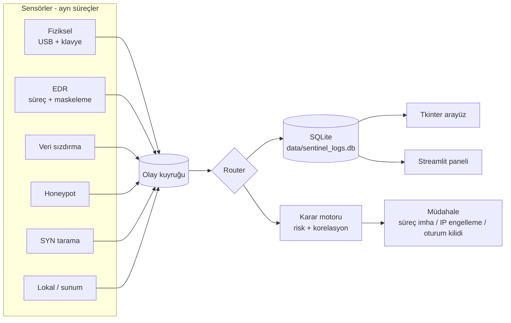

# Sentinel — Siber-Fiziksel EDR/IPS Prototipi

Sentinel, Windows için geliştirilmiş, **fiziksel katman** (USB, klavye) ile **siber katmanı** (süreç davranışı, ağ, veri sızdırma) birlikte izleyen ve olayları **korelasyonlu bir risk motorunda** birleştirerek otonom müdahale eden bir uç nokta savunma (EDR/IPS) prototipidir.

> Eğitim ve araştırma amaçlı bir projedir. Ticari bir güvenlik ürününün yerini tutmaz.

## Özellikler

| Katman | Tespit | MITRE ATT&CK |
|---|---|---|
| Fiziksel | Yeni USB cihazı (hub + USB disk) | T1200 |
| Fiziksel | BadUSB: insanüstü hızda, farklı tuşlarla enjeksiyon | T1056 / T1200 |
| Siber (EDR) | Office/PDF uygulamasından kabuk açılması | T1566, T1204 |
| Siber (EDR) | Kabukta şüpheli parametre (`-enc`, `bypass`, `hidden`, `iex`…) | T1059, T1027 |
| Siber (EDR) | Kabuğun 80/443 dışı porta ters bağlantısı | T1071 |
| Siber (EDR) | **Maskeleme:** `cmd.exe`/`powershell.exe` kopyasının başka adla çalışması (PE `OriginalFilename` kontrolü) | T1036.003 |
| Veri sızdırma | Korunan dizinin arşivlenmesi (7z, rar, tar, `Compress-Archive`) | T1560 |
| Veri sızdırma | Sürekli yüksek giden trafik | T1048 |
| Ağ | Honeypot (tuzak port) teması | T1046 |
| Ağ | SYN port taraması (scapy + Npcap) | T1046 |

### Otonom müdahale protokolleri

1. **Ağ savunması:** Tarama yapan IP, Windows Güvenlik Duvarı'nda engellenir (`netsh`, yönetici gerekir).
2. **Donanım:** BadUSB tespitinde oturum anında kilitlenir.
3. **Gölge müdahale:** Şüpheli süreç + veri sızdırma birlikte görülürse, oturum kilitlenmeden sadece ilgili süreçler sessizce öldürülür.
4. **Kill-chain:** Risk skoru ≥ 80 ise ilgili süreçler öldürülür ve oturum kilitlenir.

Güvenlik önlemleri: süreçler yalnızca **PID + başlangıç zamanı** eşleşirse öldürülür (PID yeniden kullanımına karşı), kritik Windows süreçleri korunur, IP adresleri `ipaddress` ile doğrulanır ve komutlar kabuk kullanılmadan çalıştırılır (komut enjeksiyonu yok), loopback adresleri asla engellenmez.

## Mimari



### Risk skoru

Son 10 saniyedeki benzersiz olay tiplerinin ağırlıkları toplanır. Birlikte anlam taşıyan olay çiftleri (örn. *USB + veri sızdırma*, *lokal ihlal + ağ taraması*) çarpanı artırır. Sonuç sigmoid ile 0–100 aralığına sıkıştırılır. Böylece tek başına zayıf sinyaller eşiği geçmez, birbirini destekleyen sinyaller hızla kritik seviyeye çıkar. Ayrıntılar: [`sentinel/engine/risk.py`](sentinel/engine/risk.py).

## Klasör yapısı

```
sentinel/            Ana paket
  sensors/           physical, process (EDR), exfil, network, local
  engine/            risk, fusion (karar motoru), response (müdahale)
  ui/                desktop (Tkinter), dashboard (Streamlit)
  controller.py      Süreç yönetimi ve güvenli kapanış
  database.py        SQLite log yazıcısı
  config.py          Tüm eşikler ve yollar
simulator/           Nemesis saldırı simülatörü ve demo senaryoları
tools/               Teşhis ve bakım araçları
tests/               pytest birim ve entegrasyon testleri
run.py               Başlatıcı
```

## Kurulum

Gereksinimler: Windows 10/11, Python 3.10+, SYN tarama tespiti için [Npcap](https://npcap.com).

```powershell
python -m pip install -r requirements.txt
```

## Kullanım

IP engelleme ve SYN tarama tespiti için terminali **yönetici olarak** açın.

```powershell
python run.py                  # Motor + masaüstü arayüzü
python run.py --ui dashboard   # Motor + web paneli (Streamlit)
python run.py --ui none        # Sadece motor
```

Temiz bir başlangıç için (eski logları siler, yönetici izni ister): `temiz_baslat.bat`

## Demo: Nemesis saldırı simülatörü

```powershell
python simulator\nemesis.py
```

| Senaryo | Beklenen tepki |
|---|---|
| Ağ taraması (honeypot) | Tarama tespiti, IP engelleme denemesi |
| Truva atı (gizli PowerShell) | Şüpheli süreç kaydı |
| Oltalama (Word makrosu) | Maskeleme + Office→kabuk tespiti |
| Dosyasız indirme (LoTL) | Şüpheli parametre tespiti |
| Lokal ihlal / veri paketleme | Maskeleme + korunan dizin → süreç imhası + oturum kilidi |
| Gizli veri sızdırma | Şüpheli süreç + T1560 → gölge müdahale (sessiz imha) |

> ⚠️ **Etik kullanım:** Simülatörü yalnızca kendi bilgisayarınızda veya izinli bir laboratuvar ortamında kullanın. Senaryolar zararsızdır: sistem araçlarının kopyaları kısa süre bekleyip kapanır, dış bağlantı denemeleri belgeleme amaçlı bir adrese (`192.0.2.10`) yapılır. Kendi laboratuvarınızdaki C2 makinesi için `NEMESIS_C2_IP` ortam değişkenini kullanın.

## Testler

```powershell
python -m pytest
```

Testler karar motorunu, risk skorunu, sensör kurallarını, IP doğrulamayı ve süreçler arası veri hattını (kayıpsız yazım, temiz kapanış) kapsar. Karar motoru aksiyonları uygulamadan döndürdüğü için testler ekranı kilitlemez.

## Bilinen sınırlamalar

- Yalnızca Windows'ta çalışır (WMI, `LockWorkStation`, `netsh`).
- Süreç izleme periyodik taramayla (1–2 sn) yapılır; çok kısa ömürlü süreçler kaçabilir. Üretim seviyesi bir EDR, ETW veya çekirdek sürücüsü kullanır.
- Klavye sensörü tuş içeriğini kaydetmez, yalnızca tuşlar arası süreyi ölçer.
