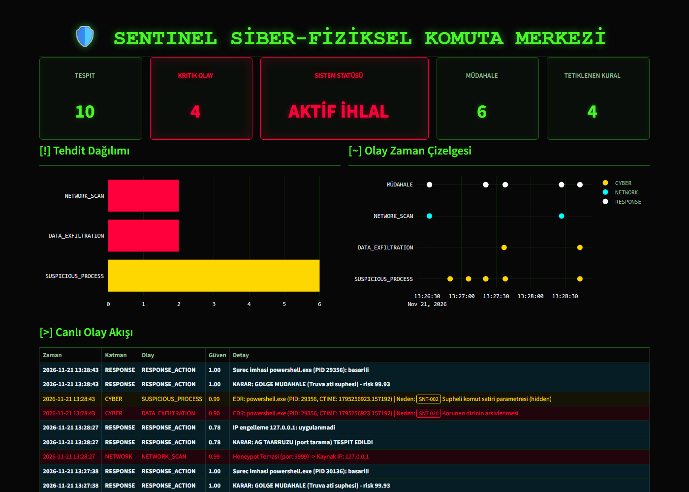
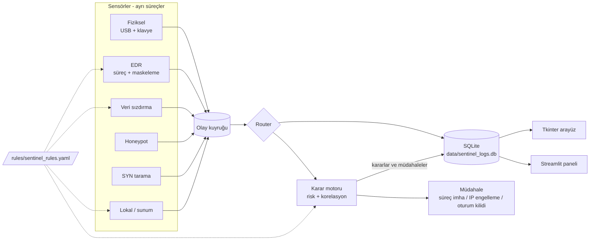

# Sentinel — Siber-Fiziksel EDR/IPS Prototipi

Sentinel, Windows için geliştirilmiş, **fiziksel katman** (USB, klavye) ile **siber katmanı** (süreç davranışı, ağ, veri sızdırma) birlikte izleyen ve olayları **korelasyonlu bir risk motorunda** birleştirerek otonom müdahale eden bir uç nokta savunma (EDR/IPS) prototipidir.

> Eğitim ve araştırma amaçlı bir projedir. Ticari bir güvenlik ürününün yerini tutmaz.



*Canlı panel: Nemesis simülatörünün ağ taraması ve gizli veri sızdırma senaryoları tespit ediliyor. Beyaz satırlar karar motorunun kararlarını ve uyguladığı müdahaleleri (süreç imhası) gösterir. Her tespit, tetikleyen kuralın kimliğiyle (`SNT-xxx`) etiketlenir.*

## Özellikler

| Kural | Katman | Tespit | MITRE ATT&CK |
|---|---|---|---|
| — | Fiziksel | Yeni USB cihazı (hub + USB disk) | T1200 |
| — | Fiziksel | BadUSB: insanüstü hızda, farklı tuşlarla enjeksiyon | T1056 / T1200 |
| `SNT-001` | Siber (EDR) | Office/PDF uygulamasından kabuk açılması | T1566.001 |
| `SNT-002` | Siber (EDR) | Kabukta şüpheli parametre (`-enc`, `bypass`, `hidden`, `iex`…) | T1059.001 |
| `SNT-003` | Siber (EDR) | Kabuğun 80/443 dışı porta dış bağlantısı | T1071 |
| `SNT-010` | Siber (EDR) | **Maskeleme:** `cmd.exe`/`powershell.exe` kopyasının başka adla çalışması (PE `OriginalFilename` kontrolü) | T1036.003 |
| `SNT-020` | Veri sızdırma | Korunan dizinin arşivlenmesi (7z, rar, tar, `Compress-Archive`) | T1560.001 |
| — | Veri sızdırma | Sürekli yüksek giden trafik | T1048 |
| — | Ağ | Honeypot (tuzak port) teması | T1046 |
| — | Ağ | SYN port taraması (scapy + Npcap) | T1046 |

`SNT-` kimlikli kurallar [`rules/sentinel_rules.yaml`](rules/sentinel_rules.yaml) dosyasında tanımlıdır (bkz. [Kural dosyası](#kural-dosyası)).

### Otonom müdahale protokolleri

1. **Ağ savunması:** Tarama yapan IP, Windows Güvenlik Duvarı'nda engellenir (`netsh`, yönetici gerekir).
2. **Donanım:** BadUSB tespitinde oturum anında kilitlenir.
3. **Gölge müdahale:** Şüpheli süreç + veri sızdırma birlikte görülürse ya da kural dosyasında `silent_kill_rules` olarak işaretlenmiş bir kural (varsayılan: `SNT-001`, Office'ten kabuk) tetiklenirse, oturum kilitlenmeden sadece ilgili süreçler sessizce öldürülür.
4. **Kill-chain:** Risk skoru ≥ 80 ise ilgili süreçler öldürülür ve oturum kilitlenir.

Güvenlik önlemleri: süreçler yalnızca **PID + başlangıç zamanı** eşleşirse öldürülür (PID yeniden kullanımına karşı), kritik Windows süreçleri korunur, IP adresleri `ipaddress` ile doğrulanır ve komutlar kabuk kullanılmadan çalıştırılır (komut enjeksiyonu yok), loopback adresleri asla engellenmez.

## Mimari



### Risk skoru

Son 10 saniyedeki benzersiz olay tiplerinin ağırlıkları toplanır (ağırlıklar kural dosyasındadır). Birlikte anlam taşıyan olay çiftleri (örn. *USB + veri sızdırma*, *lokal ihlal + ağ taraması*) çarpanı artırır. Sonuç sigmoid ile 0–100 aralığına sıkıştırılır. Böylece tek başına zayıf sinyaller eşiği geçmez, birbirini destekleyen sinyaller hızla kritik seviyeye çıkar. Ayrıntılar: [`sentinel/engine/risk.py`](sentinel/engine/risk.py).

## Kural dosyası

Tespit kuralları, risk ağırlıkları ve korelasyonlar koddan ayrı, [`rules/sentinel_rules.yaml`](rules/sentinel_rules.yaml) dosyasındadır. Yeni bir kural eklemek için kod değiştirmek gerekmez:

```yaml
process_rules:
  - id: SNT-100
    name: Regsvr32 ile uzaktan script (Squiblydoo)
    mitre: T1218.010
    process_names: [regsvr32.exe]
    cmdline_contains_any: ["/i:http"]
```

Bir kural, belirtilen **tüm** koşullar sağlandığında eşleşir. Desteklenen koşullar: `parent_names`, `cmdline_contains_any`, `cmdline_tokens_any` (tam kelime eşleşmesi), `remote_port_not_in`. Dosya başlangıçta doğrulanır: bilinmeyen alan, tekrarlanan kimlik, geçersiz port ya da tanımsız olay tipi varsa Sentinel hiçbir sensörü başlatmadan, hatanın yerini belirterek durur. Farklı bir kural dosyası için `SENTINEL_RULES` ortam değişkeni kullanılabilir.

## Klasör yapısı

```
sentinel/            Ana paket
  sensors/           physical, process (EDR), exfil, network, local
  engine/            risk, fusion (karar motoru), response (müdahale)
  ui/                desktop (Tkinter), dashboard (Streamlit)
  controller.py      Süreç yönetimi ve güvenli kapanış
  database.py        SQLite log yazıcısı
  config.py          Eşikler ve yollar
  rules.py           Kural dosyası yükleyici ve doğrulayıcı
rules/               YAML tespit kuralları
docs/                README görselleri
simulator/           Nemesis saldırı simülatörü ve demo senaryoları
tools/               Teşhis ve bakım araçları
tests/               pytest birim ve entegrasyon testleri
run.py               Başlatıcı
```

## Kurulum

Gereksinimler: Windows 10/11, Python 3.10+, SYN tarama tespiti için [Npcap](https://npcap.com).

```powershell
python -m pip install -r requirements.txt
```

## Kullanım

IP engelleme ve SYN tarama tespiti için terminali **yönetici olarak** açın.

```powershell
python run.py                  # Motor + masaüstü arayüzü
python run.py --ui dashboard   # Motor + web paneli (Streamlit, yalnızca localhost)
python run.py --ui none        # Sadece motor
python run.py --dry-run        # Tespit et, karar ver ama müdahale etme (prova / test)
```

`--dry-run` modunda süreç öldürme, IP engelleme ve oturum kilitleme yapılmaz, sadece `[DRY-RUN]` olarak loglanır. Sunumdan önce senaryoları güvenle denemek için kullanın.

Temiz bir başlangıç için (eski logları siler, yönetici izni ister): `temiz_baslat.bat`

## Demo: Nemesis saldırı simülatörü

```powershell
python simulator\nemesis.py                  # Grafik arayüz
python simulator\nemesis.py --senaryo EXFIL  # Tek senaryo, arayüzsüz
```

Aşağıdaki tepkiler, motor canlı çalışırken her senaryo tek tek tetiklenerek doğrulanmıştır:

| Senaryo | Tespit | Karar |
|---|---|---|
| `NMAP` Ağ taraması | Honeypot teması | IP engelleme (loopback hariç) |
| `TRUVA` Truva atı | `-ExecutionPolicy Bypass` + gizli PowerShell | Kayıt (tek başına zayıf sinyal) |
| `MAKRO` Oltalama | Maskelenmiş `winword.exe` + Office→PowerShell zinciri | Gölge müdahale: iki süreç sessizce öldürülür |
| `FILELESS` Dosyasız indirme | Gizli `Invoke-WebRequest` | Kayıt (tek başına zayıf sinyal) |
| `LOCAL` Lokal ihlal | Maskelenmiş `cmd.exe` korunan dizini hedefliyor | Kill-chain: süreç imhası + oturum kilidi |
| `DRIPPING` Veri paketleme | Maskelenmiş `cmd.exe` korunan dizini hedefliyor | Kill-chain: süreç imhası + oturum kilidi |
| `EXFIL` Gizli veri sızdırma | Gizli PowerShell + korunan dizinin arşivlenmesi (T1560) | Gölge müdahale: süreç sessizce öldürülür |

"Kayıt" alan senaryolar panelde görünür. Aynı 10 saniyelik pencerede başka bir sinyalle (veri sızdırma, tarama, USB) birleşirlerse müdahaleye dönüşürler.

> ⚠️ **Etik kullanım:** Simülatörü yalnızca kendi bilgisayarınızda veya izinli bir laboratuvar ortamında kullanın. Senaryolar zararsızdır: sistem araçlarının kopyaları kısa süre bekleyip kapanır, dış bağlantı denemeleri belgeleme amaçlı bir adrese (`192.0.2.10`) yapılır. Kendi laboratuvarınızdaki C2 makinesi için `NEMESIS_C2_IP` ortam değişkenini kullanın.

## Testler

```powershell
python -m pytest
```

60 test; karar motorunu, risk skorunu, sensör kurallarını, kural dosyası doğrulamasını, IP doğrulamayı ve süreçler arası veri hattını (kayıpsız yazım, temiz kapanış) kapsar. Karar motoru aksiyonları uygulamadan döndürdüğü için testler ekranı kilitlemez.

## Bilinen sınırlamalar

- Yalnızca Windows'ta çalışır (WMI, `LockWorkStation`, `netsh`).
- Süreç izleme periyodik taramayla (1–2 sn) yapılır; çok kısa ömürlü süreçler kaçabilir. Üretim seviyesi bir EDR, ETW veya çekirdek sürücüsü kullanır.
- Klavye sensörü tuş içeriğini kaydetmez, yalnızca tuşlar arası süreyi ölçer.
